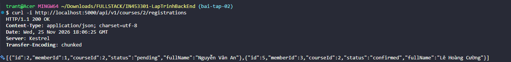
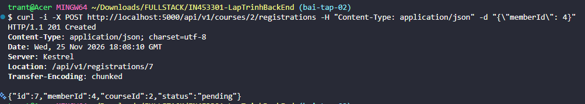
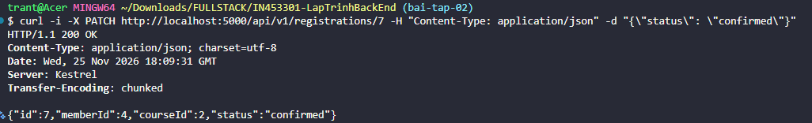
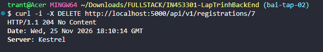
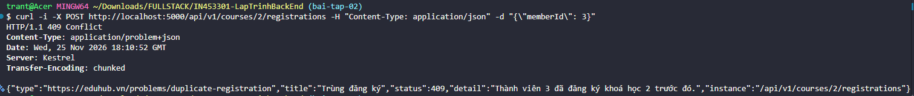

# IN4533 - Bài tập 02: EduHub mini (PostgreSQL + REST API)

- **Họ tên:** Trần Thái Kiệt
- **MSSV:** 0024418950
- **Lớp:** ĐHCNTT24A-CS
- **Học phần:** Lập trình Back End (IN4533)

## Cấu trúc thư mục

```
IN4533-BT02-0024418950/
├── sql/
│   ├── 01-schema.sql     # Tạo 3 bảng + ràng buộc
│   ├── 02-seed.sql       # Dữ liệu mẫu
│   └── 03-queries.sql    # 3 truy vấn a/b/c
├── docs/
│   ├── api.md            # Thiết kế REST API kèm JSON mẫu
│   ├── requests.md       # Các lệnh curl kiểm thử
│   └── images/           # Ảnh chụp màn hình
├── src/                  # Minimal API (ASP.NET Core + Npgsql)
└── README.md
```

## Cách cài PostgreSQL

Cài bằng Docker:

```bash
docker run --name eduhub-pg -e POSTGRES_PASSWORD=<mat_khau> -e POSTGRES_DB=eduhub -p 5434:5432 -d postgres:16-alpine
```

Dùng cổng `5434` trên máy để không trùng với PostgreSQL cài sẵn (cổng `5432`).
Lần sau chỉ cần `docker start eduhub-pg`.

Hoặc cài trực tiếp PostgreSQL rồi kết nối bằng `psql` / pgAdmin.

## Cách chạy phần cơ sở dữ liệu

Với Docker (dùng `psql` có sẵn trong container):

```bash
docker exec -i eduhub-pg psql -U postgres -d eduhub < sql/01-schema.sql
docker exec -i eduhub-pg psql -U postgres -d eduhub < sql/02-seed.sql
docker exec -i eduhub-pg psql -U postgres -d eduhub < sql/03-queries.sql
```

Với PostgreSQL cài trực tiếp:

```bash
# Tạo db
createdb -h localhost -U postgres eduhub

# Chạy lần lượt 3 file SQL
psql -h localhost -U postgres -d eduhub -f sql/01-schema.sql
psql -h localhost -U postgres -d eduhub -f sql/02-seed.sql
psql -h localhost -U postgres -d eduhub -f sql/03-queries.sql
```

Tệp `01-schema.sql` có `DROP TABLE IF EXISTS` nên chạy lại được từ đầu nhiều lần.

## Cách chạy API (phần 3.2)

Yêu cầu: .NET SDK 8.0.

```bash
cd src
# Khai báo mật khẩu thật (không commit lên GitHub):
# tạo file appsettings.Development.json từ file .example rồi điền mật khẩu
cp appsettings.Development.json.example appsettings.Development.json

dotnet restore
dotnet run --urls http://localhost:5000
```

Hoặc truyền chuỗi kết nối qua biến môi trường (Git Bash), ví dụ trỏ vào container Docker ở trên:

```bash
cd src
export ConnectionStrings__EduHub="Host=localhost;Port=5434;Database=eduhub;Username=postgres;Password=<mat_khau>"
dotnet run --urls http://localhost:5000
```

API chạy ở `http://localhost:5000`. Xem các lệnh kiểm thử trong
`docs/requests.md`.

## Các endpoint đã cài

| Method | URI | Chức năng |
|---|---|---|
| GET | `/api/v1/courses/{courseId}/registrations` | Danh sách đăng ký của khoá học |
| POST | `/api/v1/courses/{courseId}/registrations` | Tạo đăng ký |
| PATCH | `/api/v1/registrations/{id}` | Xác nhận / đổi trạng thái |
| DELETE | `/api/v1/registrations/{id}` | Huỷ đăng ký |

## Kết quả gọi thử

Chạy lần lượt các lệnh trong `docs/requests.md` ngay sau khi nạp dữ liệu mẫu.

**GET danh sách đăng ký của khoá học - 200 OK**



**POST tạo đăng ký - 201 Created**



**PATCH xác nhận đăng ký - 200 OK**



**DELETE huỷ đăng ký - 204 No Content**



**POST trùng đăng ký - 409 Conflict (Problem Details)**



## Ghi chú bảo mật

- Mật khẩu kết nối thật để trong `appsettings.Development.json` (đã `.gitignore`),
  không đưa lên GitHub theo quy định của đề.
